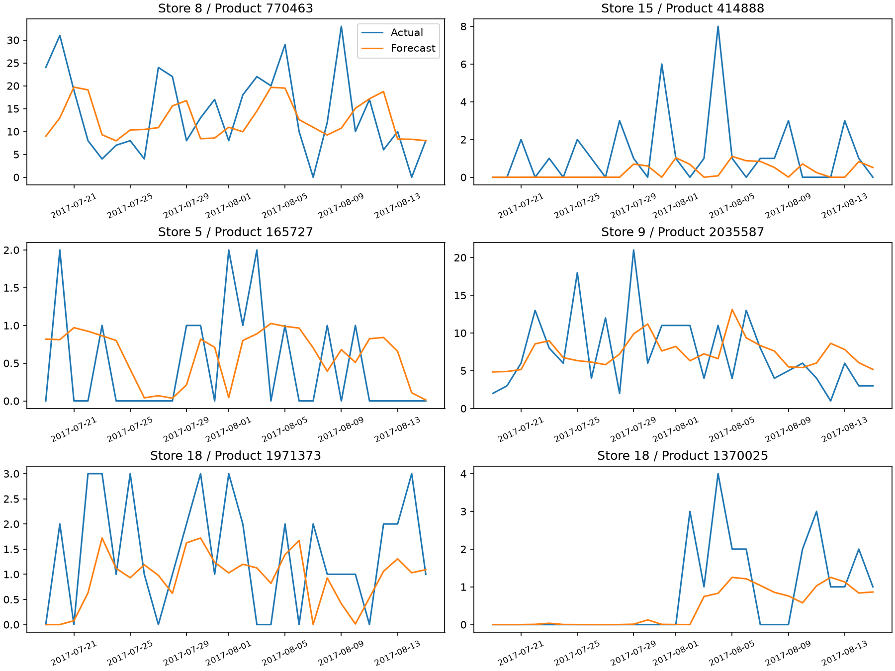

# Favorita Transformer — Reproduce 49.9963% WAPE

This repository provides the source, selected checkpoint and experimental protocol for a **49.9963% daily sales WAPE** result on the Corporación Favorita dataset. The model is trained from scratch across all stores, using **seven-day tokens, 1,099 historical days, and a 12-layer Transformer**.

[Reproduction notebook](favorita/Favorita.ipynb) · [Detailed experiment methods](favorita/README.md) · [Recorded metrics](favorita/metrics.json) · [Selected checkpoint](favorita/model.pt)

## Reference result

| Measurement | Recorded value |
|---|---:|
| Test WAPE | **49.9963%** |
| Validation WAPE | 49.1441% |
| Test period | July 19–August 15, 2017 |
| Validation period | June 21–July 18, 2017 |
| Fit target cutoff | June 20, 2017 |
| Scored item-store-day observations | 4,843,748 |
| Item-store series | 174,685 |
| Trainable parameters | 7,240,641 |
| Training windows per epoch | 183,897,562 |
| Selected checkpoint | Epoch 1, selected from 2 epochs |

WAPE is total absolute prediction error divided by total actual sales across all eligible item-store-day observations. A WAPE of 49.9963% corresponds to 0.4999634750273137 in the recorded JSON.



## Evaluation timing

**The reference score uses rolling one-day-ahead evaluation.** To forecast day t, the model receives actual sales through day t−1. Earlier actual observations within the validation and test periods therefore become history for later predictions. Model weights stay fixed during each evaluation.

Seven-day tokens encode consecutive days in the input history. The model outputs a single day's sales. The reported score depends on this daily information schedule. A 28-day forecast made from one fixed origin requires its own evaluation.

The lowest validation WAPE selects the checkpoint. Series first observed after the fit cutoff are excluded from scoring.

## Reproduce from scratch

Run all commands from the repository root in a CUDA-capable Python environment.

### 1. Set up the environment

Install a CUDA-enabled PyTorch build compatible with your GPU and driver, following the [official PyTorch installation instructions](https://pytorch.org/get-started/locally/). Then install the experiment dependencies.

~~~sh
python -m pip install -r favorita/requirements.txt
~~~

The reference training used an RTX 5080 Laptop GPU with 16 GB VRAM. The training host's package inventory read after completion was PyTorch 2.14.1+cu132, NumPy 2.5.4, pandas 3.1.1, PyArrow 26.0.1 and Matplotlib 3.11.2. Exact equivalence on a different software/GPU stack has not been established.

### 2. Obtain the data

Download and extract train.csv from the [Corporación Favorita Grocery Sales Forecasting competition](https://www.kaggle.com/competitions/favorita-grocery-sales-forecasting/data), following its access terms. Place the CSV at data/favorita/train.csv, or pass its actual path to the preparation command.

~~~sh
python favorita/prepare.py --train data/favorita/train.csv
~~~

This creates work/favorita-panel.parquet, aggregated and sorted by store, product and date. The preparation command refuses to overwrite an existing panel.

Training clips negative aggregate sales to zero. Missing daily rows after a series' first observation become zero. History before its first observation is masked. Training targets begin at max(28, first observed day + 1) within the panel, so early samples have less than three years of observed history.

### 3. Train and select the checkpoint

~~~sh
python favorita/train.py favorita long
~~~

| Setting | Value |
|---|---|
| History | 1,099 days → 157 tokens |
| Days per token | 7 |
| Encoder width / layers / heads | 128 / 12 / 8 |
| Feed-forward width / dropout | 256 / 0.05 |
| Attention | Global over available historical tokens |
| Inputs | Calendar, item-store identity, historical sales and observation indicators |
| Optimizer / learning rate | AdamW / 0.001 |
| Batch size | 1,024 |
| Training precision / objective | BF16 autocast, FP32 L1 loss |
| Epochs / seed | 2 / 42 |
| Parameter training | All parameters |
| Checkpoint selection | Lowest validation WAPE |

All stores share one trained model. The prepared panel retains promotion, while this model consumes calendar, identity and sales inputs.

Full training processes hundreds of millions of windows and can take multiple days. Validation runs after each epoch, followed by evaluation of the selected checkpoint on the test period.

### 4. Inspect the reproduced outputs

The run writes these files under outputs/:

| File | Contents |
|---|---|
| favorita-patch-long.json | Validation/test WAPE, configuration and event metrics |
| favorita-patch-long.pt | Selected model weights |
| favorita-patch-long-predictions.csv.gz | Daily actual and predicted sales by item-store |
| favorita-patch-long-series.npy | Item-store embedding order |
| favorita-patch-long.png | Example daily sales curves |

A new run overwrites the same output names. Compare the resulting JSON with [favorita/metrics.json](favorita/metrics.json) and confirm the dates, row counts and model settings as well as the WAPE.

The published [model.pt](favorita/model.pt) and [series.npy](favorita/series.npy) preserve the selected checkpoint and its embedding order. Input data and the full prediction table are prepared or regenerated locally.

## Notebook and improvement experiments

Open [favorita/Favorita.ipynb](favorita/Favorita.ipynb). It starts with the task, data schema, temporal split, model construction and recorded results. Full training and GPU validation analysis require explicit flags.

Optional improvement cells compare seasonal and trailing-mean baselines, inspect bias and promotion/volume segments, and fit scale/blend candidates on the first 14 validation days before checking the next 14. These experiments have no measured improved score yet. The reference remains **49.9963%**.

The source was retrieved from the completed training host. The published checkpoint has been checked for successful loading and finite prediction output. A complete fresh retraining of the publication package has not been executed. Numerical differences across GPU/software versions remain possible.

<details>
<summary>Earlier Walmart M5 experiments</summary>

# Earlier Walmart M5 experiments

This repository contains two experiments on the Walmart M5 sales panel. The LightGBM baseline evaluates 14- and 28-day replenishment forecasts using WAPE over historical folds. The Time-LLM experiments use WRMSSE on the 28-day M5 private evaluation window. The scores use different metrics and evaluation windows and are reported separately.

## LightGBM baseline

This project compares 14-day and 28-day sales forecasts as inputs to a replenishment simulation. The working baseline uses one direct LightGBM Poisson model per horizon and fold, with 64 features.

| Model | Days 1–14 WAPE | Full-horizon WAPE |
|---|---:|---:|
| 14-day global baseline | 72.98% | 72.98% |
| 28-day global baseline | 73.13% | 74.38% |

The store × department benchmark achieved 72.16% and 73.57% WAPE over its full 14-day and 28-day horizons. The repository includes per-fold metrics for that benchmark, the 62-feature global comparison and the 64-feature baseline.

### Reproduce the backtests

Use Python 3.12 and install the pinned packages with `python -m pip install -r requirements.txt`. Place the three M5 input CSVs in `data/` locally. The original experiment used the [Nixtla mirror](https://nixtla.github.io/datasetsforecast/m5.html) of the [Kaggle M5 Accuracy dataset](https://www.kaggle.com/competitions/m5-forecasting-accuracy/data).

```sh
python m5_lightgbm.py --sales data/sales_train_evaluation.csv --calendar data/calendar.csv --prices data/sell_prices.csv --all-stores --enriched --group-features --horizon 14 --threads 8 --output runs/baseline-14
python m5_lightgbm.py --sales data/sales_train_evaluation.csv --calendar data/calendar.csv --prices data/sell_prices.csv --all-stores --enriched --group-features --horizon 28 --threads 8 --output runs/baseline-28
```

Omit `--group-features` to reproduce the 62-feature global model. Replace it with `--grouped` to train the store, store × category and store × department benchmarks and their equal-weight average.

The forecast origins are `d_1857`, `d_1885` and `d_1913`, with 26 weekly training origins per fold. WAPE is total absolute error divided by total actual unit sales, averaged equally across folds. The planned-price scenario assumes target-week prices are known at forecast time. Sales are observed transactions. Inventory, purchase orders and lead times require separate simulation assumptions.

#### Input SHA-256 checksums

| File | SHA-256 |
|---|---|
| sales_train_evaluation.csv | c21a519596680feb86f27a9e62f6c8b583f8be60c2c195f080ae8ca2990af2b7 |
| calendar.csv | 568d0fe5f41790142379698732908e4e57432c1c6396f3f59fb880a9c2b54231 |
| sell_prices.csv | 5c7cf045b1abbdc8d5007809c40b3682c5216075937f93e2cef01caddc4a30d9 |

The sales mirror omits the composite `id` column. All 30,490 product–store series and their 1,941 daily sales values were checked against a public copy whose MD5 matches the [Zenodo record](https://zenodo.org/records/10203108).

[PowerPoint summary](docs/Walmart-M5-Forecasting-Baseline.pptx)

## Time-LLM experiments

Local CPU experiments on the 28-day M5 Accuracy private evaluation window (May 23–June 19, 2016). Models forecast 30,490 item–store series. WRMSSE uses the published weights and all 12 M5 aggregation levels. Daily residuals in the figures sum all item–store predictions and subtract actual unit sales.

| Method | WRMSSE | June 7 residual (units) |
| --- | ---: | ---: |
| Repeat last 7 days | 0.8470 | −1,861 |
| Original head | 1.2915 | +22,357 |
| Original head with calendar adjustment | 1.2719 | +23,379 |
| Shared weekly head, 32 steps | 1.1776 | +5,793 |
| Shared weekly head, 128 steps | 1.1358 | +8,454 |


The fixed-weight [origin-shift experiment](outputs/m5_shifted_origin_residuals.png) moved the largest positive residual with output position 16 across all four origins. The shared head uses a fixed seven-day basis, so predictions repeat by week. The runs use 56 input days and a frozen one-layer GPT-2 backbone. The 128-step run reproduces the first 32 training steps with the same seed, then trains for 96 additional batches. Compared with 32 steps, WRMSSE improved by 3.5%, while the June 7 overforecast grew by 2,662 units. Repeating the last seven days still had the lowest WRMSSE and the smallest absolute error on June 7.


[Daily forecasts and residuals](outputs/m5_shared_head_128_comparison.csv) · [WRMSSE by aggregation level](outputs/m5_shared_head_128_wrmsse.csv)

### Reproduce locally

Use Python 3.11, Git and PowerShell. Run from the repository root.

```powershell
python -m venv .venv-time-llm
$python = ".\.venv-time-llm\Scripts\python.exe"
& $python -m pip install torch==2.7.1 --index-url https://download.pytorch.org/whl/cpu
& $python -m pip install -r requirements-time-llm.txt

git clone https://github.com/KimMeen/Time-LLM.git work/Time-LLM
git -C work/Time-LLM checkout b13e881f86cd0475ce1b72c17110430663334955
git -C work/Time-LLM apply ../../time-llm-cpu.patch

curl.exe -fL https://raw.githubusercontent.com/Nixtla/m5-forecasts/main/datasets/m5.zip -o work/m5.zip
Expand-Archive work/m5.zip work/m5
$env:HF_HOME = "$pwd/work/hf"

& $python work/run_m5.py
& $python work/plot_residuals.py
& $python work/compare_residuals.py
& $python work/run_m5_calendar.py
& $python work/plot_calendar_comparison.py
& $python work/run_m5_shift.py
& $python work/plot_shift.py
& $python work/run_m5_shared_head.py
& $python work/plot_shared_head.py
& $python work/run_m5_shared_head_128.py --steps 128
& $python work/plot_shared_head_128.py
```

The first run downloads pretrained GPT-2 weights from Hugging Face. The plotting scripts use Windows Microsoft YaHei for Chinese labels. Raw competition files, downloaded weights and per-item output files are kept locally.

Sources: [M5 competition](https://www.kaggle.com/competitions/m5-forecasting-accuracy), [organizer data and weights](https://github.com/Mcompetitions/M5-methods), [Time-LLM upstream](https://github.com/KimMeen/Time-LLM).

</details>
