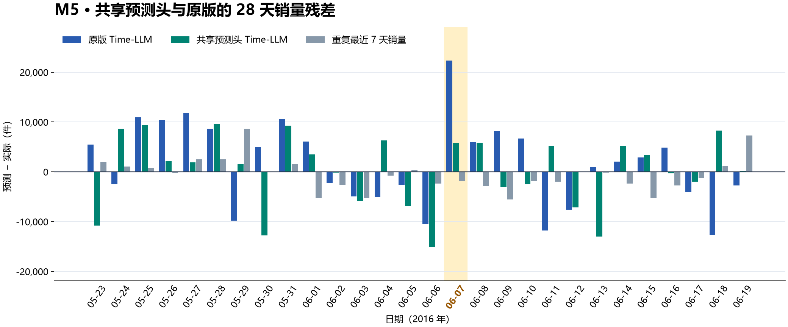
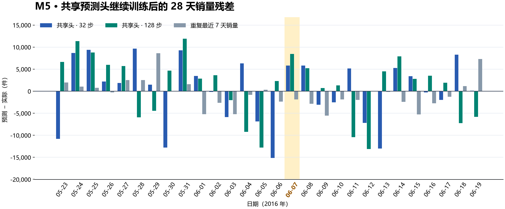

# Retail Sales Forecasting

## Favorita Transformer

The selected completed full-panel Favorita model achieved **49.9963% daily test WAPE**. It uses seven-day tokens, approximately three years of history and a 12-layer Transformer. Evaluation is rolling one-day-ahead, using actual sales through the previous day.

[English methods and reproduction guide](favorita/README.md) | [Notebook](favorita/Favorita.ipynb) | [Recorded metrics](favorita/metrics.json)

# Walmart M5 Forecasting

This repository contains two experiments on the Walmart M5 sales panel. The LightGBM baseline evaluates 14- and 28-day replenishment forecasts using WAPE over historical folds. The Time-LLM experiments use WRMSSE on the 28-day M5 private evaluation window. The scores use different metrics and evaluation windows and are reported separately.

## LightGBM baseline

This project compares 14-day and 28-day sales forecasts as inputs to a replenishment simulation. The working baseline uses one direct LightGBM Poisson model per horizon and fold, with 64 features.

| Model | Days 1–14 WAPE | Full-horizon WAPE |
|---|---:|---:|
| 14-day global baseline | 72.98% | 72.98% |
| 28-day global baseline | 73.13% | 74.38% |

The store × department benchmark achieved 72.16% and 73.57% WAPE over its full 14-day and 28-day horizons. The repository includes per-fold metrics for that benchmark, the 62-feature global comparison and the 64-feature baseline.

### Reproduce the backtests

Use Python 3.12 and install the pinned packages with `python -m pip install -r requirements.txt`. Place the three M5 input CSVs in `data/` locally. The original experiment used the [Nixtla mirror](https://nixtla.github.io/datasetsforecast/m5.html) of the [Kaggle M5 Accuracy dataset](https://www.kaggle.com/competitions/m5-forecasting-accuracy/data).

```sh
python m5_lightgbm.py --sales data/sales_train_evaluation.csv --calendar data/calendar.csv --prices data/sell_prices.csv --all-stores --enriched --group-features --horizon 14 --threads 8 --output runs/baseline-14
python m5_lightgbm.py --sales data/sales_train_evaluation.csv --calendar data/calendar.csv --prices data/sell_prices.csv --all-stores --enriched --group-features --horizon 28 --threads 8 --output runs/baseline-28
```

Omit `--group-features` to reproduce the 62-feature global model. Replace it with `--grouped` to train the store, store × category and store × department benchmarks and their equal-weight average.

The forecast origins are `d_1857`, `d_1885` and `d_1913`, with 26 weekly training origins per fold. WAPE is total absolute error divided by total actual unit sales, averaged equally across folds. The planned-price scenario assumes target-week prices are known at forecast time. Sales are observed transactions. Inventory, purchase orders and lead times require separate simulation assumptions.

#### Input SHA-256 checksums

| File | SHA-256 |
|---|---|
| sales_train_evaluation.csv | c21a519596680feb86f27a9e62f6c8b583f8be60c2c195f080ae8ca2990af2b7 |
| calendar.csv | 568d0fe5f41790142379698732908e4e57432c1c6396f3f59fb880a9c2b54231 |
| sell_prices.csv | 5c7cf045b1abbdc8d5007809c40b3682c5216075937f93e2cef01caddc4a30d9 |

The sales mirror omits the composite `id` column. All 30,490 product–store series and their 1,941 daily sales values were checked against a public copy whose MD5 matches the [Zenodo record](https://zenodo.org/records/10203108).

[PowerPoint summary](docs/Walmart-M5-Forecasting-Baseline.pptx)

## Time-LLM experiments

Local CPU experiments on the 28-day M5 Accuracy private evaluation window (May 23–June 19, 2016). Models forecast 30,490 item–store series. WRMSSE uses the published weights and all 12 M5 aggregation levels. Daily residuals in the figures sum all item–store predictions and subtract actual unit sales.

| Method | WRMSSE | June 7 residual (units) |
| --- | ---: | ---: |
| Repeat last 7 days | 0.8470 | −1,861 |
| Original head | 1.2915 | +22,357 |
| Original head with calendar adjustment | 1.2719 | +23,379 |
| Shared weekly head, 32 steps | 1.1776 | +5,793 |
| Shared weekly head, 128 steps | 1.1358 | +8,454 |



The fixed-weight [origin-shift experiment](outputs/m5_shifted_origin_residuals.png) moved the largest positive residual with output position 16 across all four origins. The shared head uses a fixed seven-day basis, so predictions repeat by week. The runs use 56 input days and a frozen one-layer GPT-2 backbone. The 128-step run reproduces the first 32 training steps with the same seed, then trains for 96 additional batches. Compared with 32 steps, WRMSSE improved by 3.5%, while the June 7 overforecast grew by 2,662 units. Repeating the last seven days still had the lowest WRMSSE and the smallest absolute error on June 7.



[Daily forecasts and residuals](outputs/m5_shared_head_128_comparison.csv) · [WRMSSE by aggregation level](outputs/m5_shared_head_128_wrmsse.csv)

### Reproduce locally

Use Python 3.11, Git and PowerShell. Run from the repository root.

```powershell
python -m venv .venv-time-llm
$python = ".\.venv-time-llm\Scripts\python.exe"
& $python -m pip install torch==2.7.1 --index-url https://download.pytorch.org/whl/cpu
& $python -m pip install -r requirements-time-llm.txt

git clone https://github.com/KimMeen/Time-LLM.git work/Time-LLM
git -C work/Time-LLM checkout b13e881f86cd0475ce1b72c17110430663334955
git -C work/Time-LLM apply ../../time-llm-cpu.patch

curl.exe -fL https://raw.githubusercontent.com/Nixtla/m5-forecasts/main/datasets/m5.zip -o work/m5.zip
Expand-Archive work/m5.zip work/m5
$env:HF_HOME = "$pwd/work/hf"

& $python work/run_m5.py
& $python work/plot_residuals.py
& $python work/compare_residuals.py
& $python work/run_m5_calendar.py
& $python work/plot_calendar_comparison.py
& $python work/run_m5_shift.py
& $python work/plot_shift.py
& $python work/run_m5_shared_head.py
& $python work/plot_shared_head.py
& $python work/run_m5_shared_head_128.py --steps 128
& $python work/plot_shared_head_128.py
```

The first run downloads pretrained GPT-2 weights from Hugging Face. The plotting scripts use Windows Microsoft YaHei for Chinese labels. Raw competition files, downloaded weights and per-item output files are kept locally.

Sources: [M5 competition](https://www.kaggle.com/competitions/m5-forecasting-accuracy), [organizer data and weights](https://github.com/Mcompetitions/M5-methods), [Time-LLM upstream](https://github.com/KimMeen/Time-LLM).
