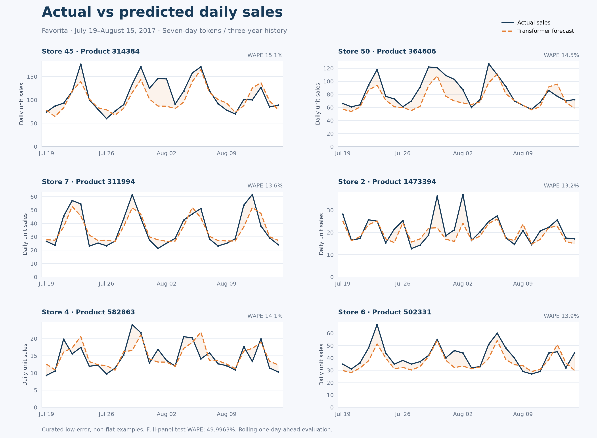
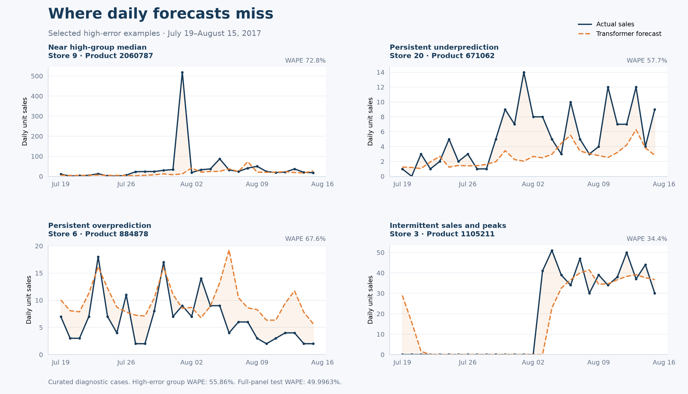

# Favorita daily sales forecasting

The selected completed full-panel experiment achieved **49.9963% test WAPE** using a fully trained Transformer with seven-day tokens and approximately three years of history.

[Start with the notebook](Favorita.ipynb). It includes optional validation inference, seasonal and trailing-mean baselines, bias and segment diagnostics, a chronological scale/blend experiment, and a prioritized plan for feature ablations. Analysis outputs are written under runs/favorita-improvement. The expensive analysis is disabled by default while other GPU jobs are running.

## Recorded results

| Metric | Value |
|---|---:|
| Validation WAPE | 49.1441% |
| Test WAPE | 49.9963% |
| Selected epoch | 1 of 2 |
| Scored daily observations | 4,843,748 |
| Item-store series | 174,685 |
| Trainable parameters | 7,240,641 |
| Training windows per epoch | 183,897,562 |
| Upward precision / recall | 63.19% / 17.95% |
| Downward precision / recall | 66.70% / 37.59% |

## Low-error and high-error product forecasts

A series is one **store × product** pair evaluated across the same 28 test days. Groups below use each series' WAPE, with a 30% cutoff. Percentages use all **172,991 scored series** as the denominator. The full panel contains 174,685 series, including series excluded by the fit-cutoff rule.

| Group | Series | Share of scored series | Group WAPE | Share of actual sales | Share of absolute error |
|---|---:|---:|---:|---:|---:|
| Low error, WAPE ≤30% | 6,316 | 3.65% | 24.75% | 18.91% | 9.36% |
| High error, WAPE >30% | 142,284 | 82.25% | 55.86% | 81.09% | 90.60% |
| Zero actual sales over all 28 days | 24,391 | 14.10% | Undefined | 0.00% | 0.04% |

Group WAPE is the sum of absolute errors divided by group actual sales, rather than an arithmetic average of per-series percentages. Zero-actual series have an undefined individual WAPE, but their prediction errors contribute to the full-panel score of **49.9963%**.

### Low-error examples

These six favorable examples span different sales levels and distinct stores/products. Selection requires 28 days, at least 26 nonzero days, mean daily sales ≥10, coefficient of variation ≥0.2 and WAPE ≤30%, followed by low-WAPE selection within sales-level bands. Their WAPE ranges from 13.18% to 15.07%. They illustrate selected successful predictions.

### High-error examples

High-group per-series median WAPE is **72.84%**, with a 90th percentile of **113.29%**. There are **36,092** positive-sales series above 100% WAPE.

The four diagnostic cases use full 28-day windows and mean daily sales ≥5. The first is close to the high-group median WAPE. The next two have net underprediction or overprediction exceeding 50% of their actual sales. The final case has 4–14 nonzero days and illustrates a transition out of a zero-sales spell. Cases are selected for visible error patterns, with distinct stores and products.

### Where high-error forecasts miss

Across the entire high-error group:

- **Underprediction accounts for 67.58% of absolute error**, compared with 32.42% from overprediction. This measures the magnitude of negative and positive daily residuals.
- Days at or above each series' own 80th-percentile actual sales, with actual sales >0, account for **51.45% of high-group error** while representing **26.05% of high-group days**. Quantile ties make the row share exceed 20%.
- Predictions on days with zero actual sales account for **10.87% of high-group error**. The model can continue forecasting demand through zero-sales spells.
- The Store 9 / Product 2060787 example misses a sharp spike. Store 20 / Product 671062 stays too low as sales rise. Store 6 / Product 884878 retains an excessive sales level. Store 3 / Product 1105211 forecasts sales at the start of a zero-sales spell and responds late when sales resume.

These are descriptive test-set diagnostics. They do not establish why a spike or zero-sales spell occurred. Promotions, stockouts and changing demand remain hypotheses requiring feature and data checks. Subsequent improvement choices should be assessed with a fresh chronological validation period because these test examples have now been inspected.

[Group counts](figures/error-groups.csv) · [Aggregate diagnostics](figures/error-diagnostics.json) · [High-error example values](figures/high-error-products.csv) · [High-error selection metrics](figures/high-error-selection.csv)

## Data and temporal evaluation

Download and extract train.csv from [Corporación Favorita Grocery Sales Forecasting](https://www.kaggle.com/competitions/favorita-grocery-sales-forecasting/data), following the competition access terms.

The daily panel spans January 1, 2013 through August 15, 2017. Fit targets end June 20, 2017. Validation runs June 21–July 18 and test runs July 19–August 15. Lowest validation WAPE selects the checkpoint.

**Evaluation is rolling one-day-ahead.** A prediction for day t uses actual sales through t-1, including earlier actual observations inside the holdout. Weights stay fixed during evaluation. A fixed-origin 28-day forecast requires a separate experiment.

WAPE is sum(abs(actual - forecast)) / sum(actual), aggregated across scored item-store-day observations. Series first observed after the fit cutoff are excluded from scoring.

The panel aggregates unit_sales by store_nbr, item_nbr and date, sorted by those keys. Negative aggregate sales are clipped to zero by the training loader. Missing daily rows after the first observation become zero. Pre-launch history is masked. Target eligibility starts at max(28, first observed day + 1), so early samples have shorter observed histories.

## Inputs and model

The inputs are calendar encodings, learned item-store identity and historical sales with an observation indicator. Calendar inputs contain elapsed years and sine/cosine weekly, monthly and annual cycles. Promotion is retained in the prepared panel. The forward pass consumes calendar, identity and sales.

Each token encodes seven consecutive days. There are 157 tokens covering 1,099 days, with global attention across available history. A width-32 daily representation is concatenated within each patch and projected to width 128. The encoder has 12 layers, 8 heads, feed-forward width 256, dropout 0.05 and learned positions. A Softplus head combines the final historical token and target-date representation.

Training uses all model parameters, AdamW learning rate 0.001, batch size 1,024, BF16 autocast, FP32 L1 loss, seed 42 and two full epochs. All stores share one model.

Event labels compare daily actual and predicted sales with the previous actual day. The threshold is max(5 units, 50% of previous sales). The absolute floor was obtained from the 75th percentile of rounded, nonzero training changes. Upward TP/FP/FN are 67,883 / 39,541 / 310,370. Downward TP/FP/FN are 116,757 / 58,283 / 193,817.

## Reproduction

Run from the repository root using a CUDA-capable Python environment. Install a PyTorch build compatible with your GPU and driver, then install the remaining packages. The training host used an RTX 5080 Laptop 16GB. Its package inventory read after training was PyTorch 2.14.1+cu132, NumPy 2.5.4, pandas 3.1.1, PyArrow 26.0.1 and Matplotlib 3.11.2.

~~~sh
python -m pip install -r favorita/requirements.txt
python favorita/prepare.py --train data/favorita/train.csv
python favorita/train.py favorita long
~~~

Full training processes hundreds of millions of windows and can take multiple days. It writes outputs/favorita-patch-long.pt, JSON metrics, CSV.GZ daily predictions, a series mapping and a plot. A new run overwrites the same output names.

model.pt is the selected checkpoint. series.npy preserves its embedding order. metrics.json and forecast.png are recorded outputs. Input data and the full prediction table can be obtained or regenerated locally.

The published source was retrieved from the completed training host. Publication edits restrict the CLI to this experiment, extract its metric helper and ensure the output directory exists. Full retraining for this publication and bitwise equivalence across GPU/software versions are unverified.

Recreate the product figures from the original prediction table:

~~~sh
python favorita/plot_products.py --predictions outputs/favorita-patch-long-predictions.csv.gz
~~~

Selected daily values and per-series WAPE are saved in figures/selected-products.csv and figures/selection-metrics.csv.

Reproduce high-error selections and group diagnostics from the same prediction file:

~~~sh
python favorita/analyze_product_errors.py --predictions outputs/favorita-patch-long-predictions.csv.gz
~~~
